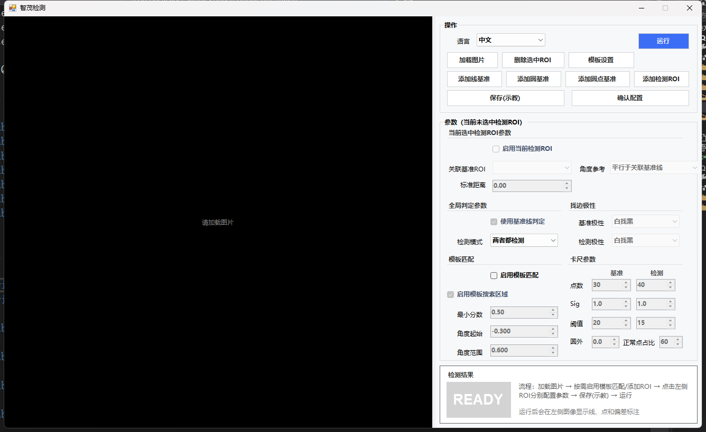
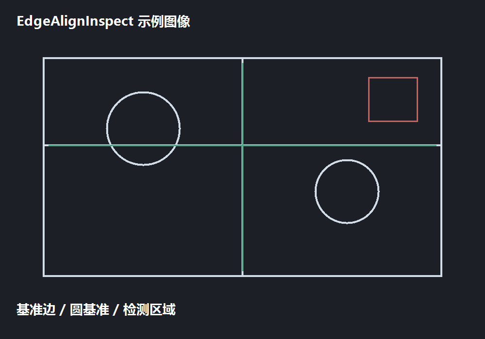

# 切割边缘检测系统操作说明书

**软件名称：** EdgeAlignInspect（智茂检测）  
**适用版本：** 当前项目版本  
**文档用途：** 现场调试、参数示教、日常检测与异常排查  
**编制日期：** 2026-09-14

## 1. 系统用途

本软件用于对切割后的产品边缘进行视觉检测。操作员在示教阶段加载一张合格图像，配置基准 ROI、检测 ROI 和卡尺参数；运行阶段，程序在当前图像中寻找边缘点，拟合基准线或圆，并计算检测边缘相对基准的偏差，最终输出 OK/NG 以及毛刺、凹陷、超边、漏铜等结果。

软件支持以下典型场景：

- 直线边、台阶边和产品外轮廓：使用“线基准”。
- 圆孔、圆形标记和光斑：使用“圆基准”或“圆点基准”。
- 切割边缘缺陷：使用“检测 ROI”，可检测毛刺、凹陷或两者。
- 产品位置有平移/旋转：启用“模板匹配”，让 ROI 随产品自动跟随。

## 2. 精度说明（0.035 mm/像素与 0.05 mm 要求）

如果现场标定结果为 **0.035 mm/像素**，而切割检测指标为 **±0.05 mm**，从分辨率角度看具备实现条件：

| 项目 | 数值 | 说明 |
|---|---:|---|
| 像素当量 | 0.035 mm/px | 标定后 X/Y 方向的实际尺寸换算系数 |
| 允许误差 | ±0.05 mm | 需先确认客户是按单边公差还是总带宽定义 |
| 允许误差对应像素 | 约 ±1.43 px | 0.05 ÷ 0.035 |
| 理论量化误差 | 约 ±0.0175 mm | 仅考虑像素取整时的误差 |

需要特别区分：**像素当量是分辨率，不是最终测量精度**。最终精度还会受到镜头畸变、标定板质量、工件振动、安装重复性、光照、切口毛刺和边缘算法的影响。建议将综合误差预算控制在 0.05 mm 以内，并使用同一工件重复测量至少 30 次，确认平均值、最大偏差和 3σ 均满足客户验收标准。

## 3. 界面总览



图 1　软件真实运行界面（未加载图像时）

界面从左到右分为三部分：

1. **图像区**：显示原图、ROI、拟合线/圆、边缘点和偏差标注。
2. **操作区**：加载图像、添加/删除 ROI、模板设置、保存示教、运行和确认配置。
3. **参数与结果区**：编辑当前 ROI 参数，查看 OK/NG、失败项和统计信息。

图像区底部提示语中的“点击 ROI 进行选中、拖动、旋转和缩放”是日常编辑 ROI 的主要方式。运行后，结果线、边缘点和偏差值会直接叠加在图像上。

## 4. 标准操作流程

```text
加载图片 → （可选）模板设置 → 添加基准 ROI → 添加检测 ROI
       → 点击图像中的 ROI 配置参数 → 保存(示教) → 运行验证 → 确认配置
```

### 4.1 加载图像

点击“加载图片”，选择待检测的灰度或彩色图像。示教时应优先使用一张边缘清晰、位置居中的合格图像。图像尺寸、镜头倍率和现场生产图像应保持一致。

本项目没有内置客户样图。下面的示例图用于说明 ROI 布置方式，不代表客户产品的真实外观：



图 2　ROI 布置示例图（演示用）

### 4.2 配置基准

1. 点击“添加线基准”，在图像中拖出覆盖稳定直边的旋转矩形；或点击“添加圆基准”，分别配置两个圆形区域；圆形定位点场景可使用“添加圆点基准”。
2. 让 ROI 覆盖真实边缘，但不要把大面积背景、反光、孔洞或明显毛刺全部包含进来。
3. 线基准用于拟合直线；圆基准用于拟合圆心，两个圆心连线可作为后续检测的方向参考。

### 4.3 配置检测 ROI

1. 点击“添加检测 ROI”。
2. 在需要检查的切割边缘上放置 ROI，长边沿边缘方向，搜索方向垂直于边缘。
3. 点击图像中的检测 ROI，使其成为当前 ROI，右侧“参数（当前：检测1）”才会切换为该 ROI 的参数。
4. 勾选“启用当前检测 ROI”，选择关联基准 ROI、角度参考和检测模式。

### 4.4 保存、运行与确认

- **保存(示教)**：将当前 ROI 和参数写入当前 Job。建议每次修改关键参数后都保存一次。
- **运行**：使用当前图像和当前界面参数执行一次检测，用于验证 ROI、找边和判定效果。运行前程序会按界面最新参数重新生成本次检测配置。
- **确认配置**：结束示教并将 Job 返回给上位机。取消窗口不会返回新的 Job。

## 5. 操作区按钮说明

| 控件 | 用途 | 推荐使用时机 | 注意事项 |
|---|---|---|---|
| 语言 | 切换中文/英文界面 | 交付不同语言现场 | 切换只影响显示文本，不改变算法参数 |
| 加载图片 | 打开一张待检测图像 | 示教或复核新图像 | 加载后应确认图像方向、尺寸和亮度与生产一致 |
| 删除选中ROI | 删除当前被选中的 ROI | ROI 画错或重复添加时 | 删除前确认当前选中对象，避免误删基准 |
| 模板设置 | 打开模板 ROI、搜索区域、角度范围等设置 | 产品位置会变化时 | 模板分数过低会导致后续 ROI 无法跟随 |
| 运行 | 执行一次检测并刷新结果 | 调参、换图验证、验收 | 运行使用当前界面值；未保存也可预览 |
| 添加线基准 | 新增直线基准 ROI | 检测直边、轮廓边、台阶边 | ROI 内应有稳定且连续的边缘 |
| 添加圆基准 | 新增圆形基准 | 圆孔、圆环、圆形标记 | 圆边缘应尽量完整，避免遮挡和反光 |
| 添加圆点基准 | 新增圆点定位基准 | 需要用圆点确定位置/方向时 | 与普通圆基准的用途不同，按现场工艺选择 |
| 添加检测ROI | 新增一块缺陷检测区域 | 每个需要单独判定的切割段 | 一个 ROI 对应一个局部检测结果 |
| 保存(示教) | 保存当前示教 Job | 参数确认、交付前 | 只保存示教参数，不等于执行检测 |
| 确认配置 | 关闭配置并返回 Job | 示教完成交给上位机 | 确认前应至少成功运行一张 OK 图 |

## 6. 参数区逐项说明

### 6.1 当前检测 ROI 参数

| 参数 | 含义 | 设置建议 |
|---|---|---|
| 启用当前检测ROI | 是否参与本次检测 | 暂时不用的 ROI 可取消勾选，不必删除 |
| 关联基准ROI | 选择该检测段使用的线基准 | 选择距离最近、边缘方向一致的基准 |
| 角度参考 | 决定检测方向随哪条基准变化 | 产品有旋转时建议使用“平行于关联基准线” |
| 标准距离(mm) | 该检测边缘相对基准的理论距离 | 使用图纸或实测合格样品填写，单位为 mm |
| 使用基准线判定 | 用关联基准线作为判定参考 | 图纸基准明确时勾选；局部形状复杂时可改用自身拟合线 |
| 检测模式 | 毛刺、凹陷或两者 | 常规切割验收选择“两者都检测” |

### 6.2 模板匹配

| 参数 | 含义 |
|---|---|
| 启用模板匹配 | 先在当前图像中定位产品，再变换 ROI |
| 启用模板搜索区域 | 限制模板搜索范围，减少误匹配和计算时间 |
| 最小分数 | 模板匹配最低接受分数，越高越严格 |
| 角度起始/角度范围 | 允许模板旋转的搜索区间，单位为弧度 |

当产品位置稳定时可以关闭模板匹配；当产品存在平移或旋转时，应在示教图中选择纹理稳定、区分度高的模板区域，并用多张不同位置的图像验证。

### 6.3 找边极性

“基准极性”和“检测极性”分别控制卡尺寻找由暗到亮、由亮到暗或自动选择的边缘方向。若运行后边缘点落在背景侧、结果整体偏移或点数明显不足，优先检查极性、阈值和 ROI 搜索方向。

### 6.4 卡尺参数

| 参数 | 作用 | 调参方向 |
|---|---|---|
| 点数 | 沿 ROI 生成的卡尺测量数量 | 边缘较长可增加；速度要求高可适当减少 |
| Sigma | 边缘平滑程度 | 噪声大时增加，细小缺陷可能因此被平滑掉 |
| 阈值 | 边缘响应最低门限 | 点数不足时适当降低，误检多时提高 |
| 圆外扩 | 圆基准搜索起点向外扩距离 | 仅圆基准相关，需避开内部亮斑 |
| 正常点占比 | 拟合时要求的有效点比例 | 边缘遮挡较多时需结合现场稳定性设置 |

## 7. 检测结果判读

运行完成后，右下角“检测结果”区域显示状态：

- **OK**：模板匹配、基准拟合、检测 ROI 和公差判定均通过。
- **NG**：至少一个环节失败，图像区会显示失败 ROI、边缘点或偏差标注。
- **READY/WAIT**：尚未完成一次有效运行，或参数刚被修改等待重新运行。

结果摘要通常包含：检测模式、模板匹配状态、检测 ROI 数量、失败项数量、毛刺数、凹陷数、超边数和漏铜数。结果提示中的 Δ 最小、Δ 最大和 Δ 平均以像素显示；若需要换算为实际尺寸，可按下式计算：

```text
实际偏差(mm) = 像素偏差(px) × 像素分辨率(mm/px)
```

### 7.1 一个完整判定实例

假设现场标定为 0.035 mm/px，检测 ROI 的标准距离为 2.000 mm，客户允许偏差为 ±0.050 mm：

| 测量项 | 示例值 | 换算/判定 |
|---|---:|---|
| 实测距离 | 2.032 mm | 偏差 +0.032 mm，判定 OK |
| 实测距离 | 1.963 mm | 偏差 -0.037 mm，判定 OK |
| 实测距离 | 2.058 mm | 偏差 +0.058 mm，判定 NG（超出 0.050 mm） |
| 像素偏差 | 1.66 px | 1.66 × 0.035 = 0.0581 mm，判定 NG |

该实例说明：软件可以在像素坐标中完成边缘定位，再根据 X/Y 像素分辨率换算为毫米进行判定。最终验收仍应以标定件和连续重复测量结果为准。

## 8. 上位机调用示例

配置界面由上位机调用时，主要有“示教”和“运行”两步：

```csharp
var sdk = new TemplateEdgeInspectSdk();
var options = new EdgeInspectionToleranceOptions
{
    BurrToleranceMm = 0.05,
    DentToleranceMm = 0.05,
    OverEdgeToleranceMm = 0.05,
    CopperLeakToleranceMm = 0.05,
    PixelResolutionX = 0.035,
    PixelResolutionY = 0.035
};

EdgeInspectJob job = sdk.OpenSetupDialog(image, currentJob, options);

EdgeInspectResult result = sdk.RunInspection(
    image, job, acceptedTolerance: 0.05,
    pixelResolutionX: 0.035, pixelResolutionY: 0.035);
```

现场集成时应保证示教阶段和运行阶段使用同一套像素分辨率、图像坐标方向及单位定义。

## 9. 常见问题与排查顺序

### 9.1 运行提示“请先加载图片”

点击“加载图片”并确认图像已显示在左侧画布；如果文件格式或路径不可读，换用现场采集的标准图像重新导入。

### 9.2 模板匹配 NG

依次检查模板 ROI 是否覆盖稳定纹理、最小分数是否过高、角度起始/范围是否覆盖实际旋转、搜索区域是否把产品排除在外，以及当前图像亮度是否与示教图差异过大。

### 9.3 边缘点太少或点落在错误位置

先确认 ROI 长边是否贴合边缘、卡尺搜索方向是否正确，再调整极性、阈值、Sigma 和点数。不要一开始就大幅扩大 ROI，否则容易把相邻边缘和噪声一起纳入。

### 9.4 结果在 OK/NG 之间跳动

检查光源稳定性、工件夹紧和平台重复定位；固定相机与镜头后，用同一工件连续运行 30 次，观察偏差均值和 3σ，再决定是否需要收紧或放宽算法参数。

### 9.5 结果显示单位与客户图纸不一致

确认 `PixelResolutionX/Y` 的单位为 mm/px，确认客户要求是单边 ±0.05 mm 还是总宽度 0.05 mm，并在验收记录中写明换算公式和公差方向。

## 10. 现场交付检查表

- [ ] 相机、镜头、光源和安装位置已固定。
- [ ] X/Y 像素分辨率已用标定板确认并记录。
- [ ] 至少一张合格图像完成模板/ROI 示教。
- [ ] 每个检测 ROI 均已设置启用状态、基准、标准距离和检测模式。
- [ ] OK 样品运行结果稳定，无误报。
- [ ] 人为制造的毛刺、凹陷或超差样品可以稳定判为 NG。
- [ ] 连续重复测量结果满足 0.05 mm 精度要求。
- [ ] 已点击“保存(示教)”并通过“确认配置”交给上位机。
- [ ] 已留存示教图、参数 Job、标定记录和验收数据。

